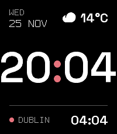
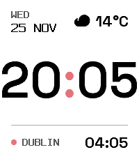

# Homeface

A Pebble Time 2 watchface showing the time, date, weather and a second time zone, written in Alloy.
Forked from [Homezone](https://github.com/ciaranpflanagan/pebble-watchfaces/tree/main/console-watchface)
by Ciaran Flanagan.

<p>
  
  
</p>

## Build

```sh
pebble build
pebble install --phone <phone-ip>
```

## Fonts

The fonts in `src/embeddedjs/assets` are generated; edit the sources and rerun the tool:

- `tools/pixfont.py`: pixel fonts from `fonts-src/*.txt`.
- `tools/iconfont.py`: weather icons from `fonts-src/phosphor`.
- `tools/metrics.py`: refreshes `src/embeddedjs/metrics.js` after a font change (run between two builds).

## Privacy

Your phone's location is sent to [Open-Meteo](https://open-meteo.com) to fetch the weather. Nothing
else leaves the phone, and nothing is collected or stored by Homeface.

## Licence

MIT, see [LICENSE](LICENSE). Space Grotesk and the pixel fonts are under the SIL OFL 1.1
(`src/embeddedjs/assets/OFL.txt`); Phosphor icons and Clay are MIT. Weather data by Open-Meteo.
